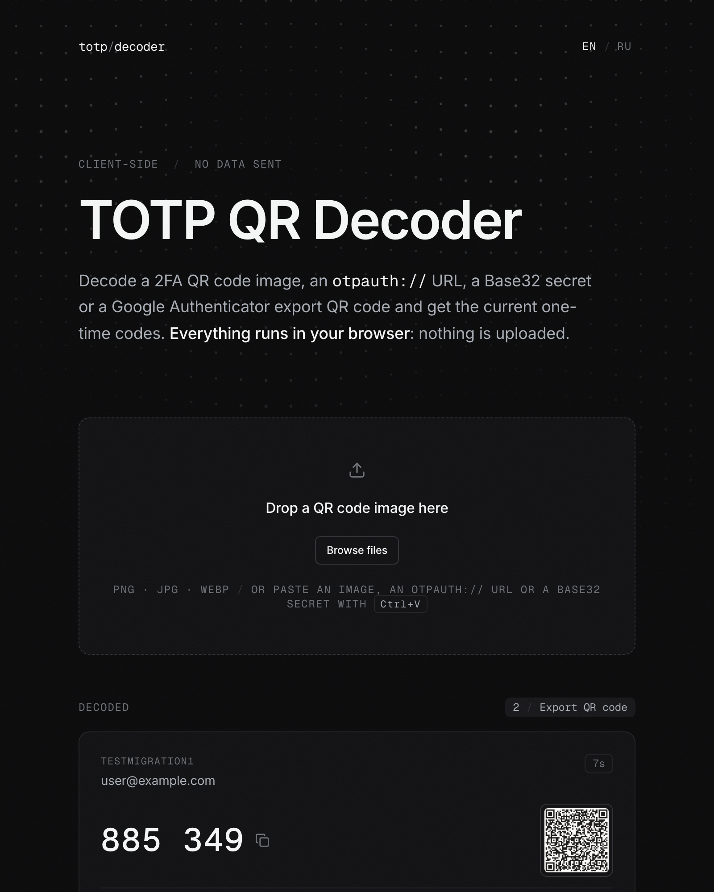

# TOTP QR Decoder

Decodes a 2FA QR code image, an `otpauth://` URL, a Base32 secret or a Google Authenticator export QR code into live one-time codes. It runs in the browser and uploads nothing.

Use it at [totp.onlyyaml.dev](https://totp.onlyyaml.dev/) ([Russian version](https://totp.onlyyaml.dev/ru/)).



## Run locally

Requires Node.js 20.19 or later in the 20 line, or 22.12 or later.

```bash
npm install   # installs the dependencies of web/
npm run dev   # serves http://localhost:3000
```

Open http://localhost:3000 and drop `test/test-qr-30s.png` onto the page. The page shows the account `TestService1` with a six-digit code that changes every 30 seconds.

`npm run build` writes the production build to `web/dist`.

## Links

- [How the page keeps secrets in the browser, and how to verify it](https://totp.onlyyaml.dev/#safety)
- [Supported input and the `otpauth://` URL format](https://totp.onlyyaml.dev/#decode)
- [Test QR codes](test/TEST-QR-CODES.md)
- [DeepWiki](https://deepwiki.com/VizzleTF/totp_decoder)
- [MIT license](LICENSE)
- Support the author: [Buy Me a Coffee](https://www.buymeacoffee.com/vizzletf), [Boosty](https://boosty.to/vizzletf/donate)
